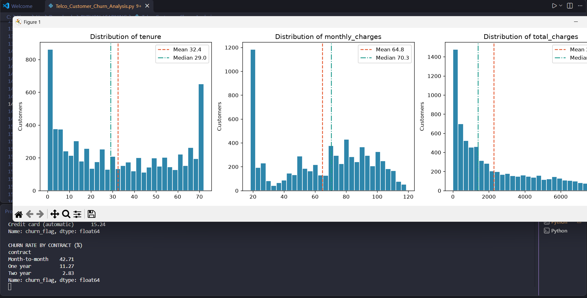

# Business Analyst Internship - Saiket Systems | Python

## 📊 Overview
Business Analysis project completed during internship at Saiket Systems. Performed end-to-end data analysis and predictive modeling using Python.

## 🖼️ Project Preview

## 🛠️ Tech Stack
- **Pandas** - Data cleaning & manipulation
- **Matplotlib & Plotly** - Data visualization
- **SciPy** - Statistical analysis
- **Scikit-learn** - Machine learning & predictive modeling
- **Jupyter Notebook**

## 📈 What I Did
- Data cleaning and preprocessing with Pandas
- Exploratory Data Analysis (EDA)
- Statistical analysis with SciPy
- Interactive visualizations with Plotly & Matplotlib
- Built ML models with Scikit-learn
- Business insights & recommendations

## 💡 Key Skills (Business Analyst)
Requirements Analysis | Data Analysis | Data Visualization | Predictive Modeling | Python | Stakeholder Reporting

## 📁 Files
- `analysis.ipynb` - Main analysis notebook
- `dataset.csv` - Dataset
- `requirements.txt` - Libraries used

## 🏢 Company
Saiket Systems - Business Analyst Intern
